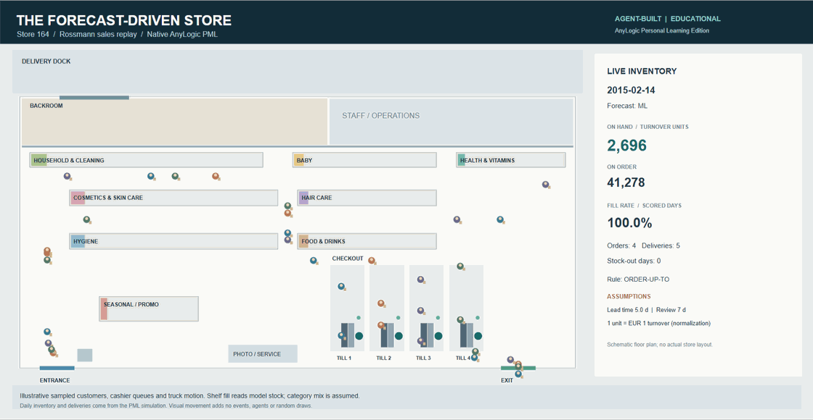

# The forecast-driven store

**Can a better sales forecast help a store serve more demand with the same inventory?**

This project connects a forecasting pipeline for **1,115 Rossmann stores** to an animated
**AnyLogic replenishment simulation for one store**. It follows the decision from cleaned
sales data to forecasts, stock targets, purchase orders, deliveries and demand served.

**SQL · Python · Excel · AnyLogic** | Educational portfolio project | Directed by Taim Salimoun

## See the store simulation in action



**[Watch / download the 18-second MP4](anylogic/model/store-animation.mp4)** ·
[Full-resolution still](anylogic/model/store-view.png) ·
[Read the illustrated report (PDF)](anylogic/model/model-description.pdf)

This is a recording of the **running native AnyLogic model**. The panel shows model stock,
outstanding orders, fill rate and date. Shelves reflect aggregate stock; the store layout,
category allocation, customer/cashier activity and truck movement are illustrative.
This view explains replenishment rather than estimating checkout performance.

## The problem and the approach

A more accurate forecast is useful only if it changes a decision. Too much stock ties up
capital; too little leaves demand unserved. The project compares ordering rules at **equal
stock** and **equal service**, instead of judging the forecast by its accuracy score alone.

The workflow has two connected parts:

1. **Forecast and calibrate.** SQL cleans the sales data; Python backtests five forecasting
   methods and exports forecasts and error distributions. An Excel workbook explores
   assumed inventory costs and sensitivities.
2. **Simulate the decision.** AnyLogic replays store 164's sales, reviews stock every seven
   days and sends orders through a supplier delay. It compares ML, last-same-weekday naive,
   static historical-demand and oracle rules. An independent Python replica checks native
   results and supports larger service–stock experiments.

Rossmann provides **sales, not inventory operations**. Lead times, costs and starting-stock
rules are explicit assumptions. One stock unit is a turnover-based normalization, not a
physical item. The oracle uses actual future sales as an unavailable-information reference.

## Key results

| Question | Result | Evidence |
|---|---|---|
| How accurate are the forecasts? | ML WAPE **9.62%**, versus **18.08%** for the four-week same-weekday average, across 1,115 stores | [Pipeline run summary](outputs/run_summary.json) |
| At the same stock, which rule serves more demand? | At **22,000 mean closing stock**, ML fill **98.91%** versus static **96.31%**; paired difference **+2.60 percentage points**, 95% CI **1.69–3.51** | [Interpolated Python-replica comparison](anylogic/results/analysis/frontier/fair_comparison.json) |
| How much stock is needed for 99% fill? | ML **22.2k**, static **25.6k**, naive **29.6k**; static needs about **15% more** than ML in this replay | [Python-replica mean-curve interpolation](anylogic/results/analysis/frontier/stock_needed_for_service.csv) |
| Does the replica match AnyLogic? | **30 baseline runs + 16 spot checks** agree within **1.82 × 10⁻¹¹** | [Baseline checks](anylogic/results/analysis/analysis.json), [spot checks](anylogic/results/analysis/native_spotchecks.json) |
| Does animation preserve the results? | A separate full run exactly matches **171 daily records**, deliveries and random draws; all **17 summary values** have zero difference | [Animated-run regression](anylogic/results/analysis/animation_verification.json) |

WAPE is total absolute forecast error divided by total actual sales; lower is better.
Fill rate is the share of replayed demand served. The inventory figures above assume a
five-day mean lead time. Inventory confidence intervals vary **ten lead-time seeds only**.
P1's four-week forecasting baseline differs from P2's last-same-weekday ordering baseline.


The base service–stock grid contains **840 Python-replica evaluations**. Selected native
checks support implementation agreement; the full grid was **not** run in AnyLogic.

## Explore the evidence

- [Model report](anylogic/docs/report.md) — assumptions, block logic, experiments, uncertainty and conclusions.
- [PDF model description](anylogic/model/model-description.pdf) — a ten-page companion for offline review.
- [Pipeline methods](docs/PIPELINE.md) — cleaning, forecasting, error calibration and Excel results.
- [AnyLogic model and run guide](anylogic/README.md) — native/replica verification and execution commands.
- [Excel assumptions workbook](excel/assumptions_and_sensitivity.xlsx) — formulas and sensitivity tables; 11 Excel/Python comparisons passed.
- [Power BI build guide](powerbi/BUILD-GUIDE.md) — aggregate CSV inputs and DAX are included; a finished `.pbix` is not.

## Run it yourself

Use **Python 3.12**. From the repository root:

```bash
python -m venv .venv
# Activate .venv for your operating system, then:
python -m pip install -r requirements.txt
python -m pytest tests anylogic/tests -q
python run_pipeline.py --demo --skip-excel-check
```

The synthetic demo requires no Rossmann download. The combined suite passed **56 tests**
on the build machine, including Excel parity. Excel recalculation additionally requires
Windows, installed Excel and pywin32; the demo command above explicitly skips that step.

For real-data reproduction, obtain your own `train.csv` and `store.csv` after accepting
the competition rules; follow [data/README.md](data/README.md). Then run:

```bash
python run_pipeline.py
python anylogic/tools/build_model.py
```

Open the regenerated `anylogic/model/P2_Rossmann_Replenishment.alp` in **AnyLogic 8.9.10
Personal Learning Edition** and choose **Animation**. This native quickstart uses the
real-data exports for store 164. The synthetic command above tests the pipeline; it
does not reproduce the published real-data results or supply store 164's native inputs.
Regenerate after moving the checkout so local data/output paths resolve correctly.
Native runtime helpers currently target Windows; no AnyLogic runtime is redistributed.

## Repository map

| Folder | Purpose |
|---|---|
| `sql/`, `analysis/`, `tests/` | Cleaning, forecasting, calibration, workbook generation and pipeline tests |
| `outputs/` | Shareable forecast/calibration summaries and the P2 file contract |
| `excel/`, `powerbi/` | Assumptions workbook; dashboard inputs, DAX and instructions |
| `anylogic/tools/`, `anylogic/model/` | Model generator, native scene, `.alp`, animation and PDF |
| `anylogic/analysis/`, `anylogic/results/analysis/` | Independent replica, comparisons, aggregate results and charts |
| `anylogic/docs/`, `anylogic/tests/` | Report, portfolio wording and model tests |

## Scope, authorship and limitations

**Taim Salimoun directed the work; Claude/Codex AI agents produced the implementation
and documentation.** This is an educational decision-model study. Taim's independent
baseline/inventory-loop rebuild remains a separate learning exercise; the repository
does not claim that he hand-coded the agent-produced implementation.

The January–June 2015 window supplies calibration, policy tuning and evaluation; July
has not been evaluated as a holdout. Store closures and known-calendar assumptions affect
forecasts; recorded sales may hide historic stock-outs. Closing stock is not a continuous-time
average, and initial-stock/end-window conventions affect comparisons. The results are
exploratory, assumption-dependent and do not establish realised savings or commercial readiness.
See the report for the complete assumptions and sensitivities.

**No raw data, store-day forecasts, residual traces, daily native logs or private
conversations are distributed.** Readers must obtain source data separately.
AnyLogic PLE's educational-use terms apply to use of that software.

Original code and documentation are available under the [MIT license](LICENSE).
Third-party data, software and brand notices are in [NOTICE.md](NOTICE.md).
