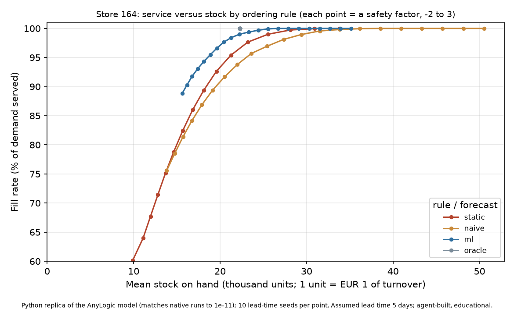

# Forecast-informed replenishment for one Rossmann store (P2)

| Item | Current result / status |
|---|---|
| Question | How much demand can each ordering rule serve for the same stock, and how much stock does it need for the same service? |
| Inventory model | Store 164; daily sales, seven-day review, order agents and supplier delivery delay in AnyLogic PLE |
| Rules | ML, last-same-weekday naive and oracle forecasts; static rule based on historical calendar-day mean and spread |
| Native evidence | 30 original runs + 16 additional spot checks matched by an independent Python replica; one separate full animated regression exactly matches the native ML baseline. One earlier static check is separate |
| Numerical agreement | Maximum absolute discrepancy 1.82 × 10⁻¹¹ across the original/new check sets; 16/16 new common-random-number and daily sales-balance checks passed |
| Equal-stock result | At 22,000 mean closing stock, ML promotion-day fill 99.81% versus static 95.87%; paired difference +3.94 percentage points (95% CI +2.97 to +4.92). **Interpolated Python-replica result** |
| Equal-service result | For 99% fill: ML 22.2k, static 25.6k, naive 29.6k stock units. **Python-replica mean-curve interpolation**, assumed five-day lead time |
| Animation | Native 2D scene visually verified and authentically recorded; full 171-day animated run passed exact daily/delivery/random-stream regression with zero summary difference |
| Reporting | [Model report](docs/report.md), [PDF model description](model/model-description.pdf), [portfolio drafts](docs/PORTFOLIO-COPY.md), replica charts and saved aggregate results |
| Personal steps remaining | Taim's independent rebuild and Power BI Desktop dashboard; code, inventory verification and native 2D animation are complete for this single-store version |

Built by Claude/Codex AI agents under **Taim Salimoun's direction** (tier B attribution), for educational portfolio use with AnyLogic Personal Learning Edition. This is an inventory replay under operating assumptions, not client work or a live store twin. Raw Rossmann data and per-store-day derived files are excluded from redistribution.

## Read the result correctly

The model replays recorded store sales from **5 January to 24 June 2015**, with 159 scored calendar days after a 12-day warm-up. Rossmann records turnover, not physical units or unconstrained customer demand. One inventory unit represents one assumed EUR of turnover. There are no real stock, orders, supplier lead times or costs in the dataset.

At equal closing stock, ML serves more demand in this replay, particularly on promotion days. At 99% fill, static needs about **15% more stock than ML** and naive about **33% more**. These frontier findings come from the Python replica; the full grid was not run natively in AnyLogic. Safety offsets were tuned/interpolated on the evaluation period. Confidence intervals cover ten lead-time seeds only, not demand uncertainty or model-selection uncertainty.



The full [report](docs/report.md) explains the file contracts, block logic, experiment tables, interpolation methods, sensitivity and limitations. The [portfolio copy](docs/PORTFOLIO-COPY.md) supplies CV wording and a LinkedIn draft; posting the draft and editing Taim's actual CV remain separate actions.

## How the model works

`dayTick` (Source) → `daySink` (Sink) creates one daily token at midday. It serves demand from on-hand stock, records lost demand and reviews the inventory every seventh day.

`orderSource` (manual Source) → `leadDelay` (Delay) → `orderSink` (Sink) creates one Order agent per purchase order. The delay makes a midday order arrive at the start of its delivery day. Receipt transfers quantity from on-order to on-hand stock.

| Rule | Order-up-to target |
|---|---|
| Forecast-driven | Sum of the next `R + ceil(L)` available daily forecasts + `z × error_RMSE × sqrt(R+L)` |
| Static | Historical calendar-day mean × `R + ceil(L)` + `z × historical_SD × sqrt(R+L)` |

Both order `max(0, target − onHand − onOrder)`. Oracle uses actual future sales and zero forecast error; it is an unavailable-information reference, not an optimised minimum-stock policy. Initial stock is the first protection window's actual demand, shared across rules. Lead times use `java.util.Random(20000 + repSeed)`, with one draw at every review even if no order is placed, so policies see common random numbers.

P1 supplies `store_day_demand.csv`, `forecast_oracle.csv`, `forecast_naive.csv`, `forecast_ml.csv` and `forecast_error_distribution.csv`. Forecasts were issued at least five days before their target dates (horizons 5–11). P2's naive is the last-same-weekday baseline; it differs from P1's stronger four-week-average baseline.

## Assumptions and limits

| Setting | Base assumption |
|---|---|
| Supplier lead time | 4/5/6 days, probabilities 0.25/0.50/0.25 |
| Review interval | 7 calendar days |
| Holding rate / gross margin / order cost | 25% yearly / 30% / EUR 50 |
| Initial native safety factor | 1.64485 |
| Replica safety-offset grid | −2 to 3 in steps of 0.25; ten seeds per rule/offset |
| Mean stock | Mean **daily closing stock**, not continuous-time average stock |
| Cost | Holding + lost-margin + scored order costs; an assumed accounting model, not measured savings |

Error calibration and frontier tuning use the same January–June data being evaluated. July 2015 is untouched. Store 164 has no raw July–December 2014 observations; panel completion treats them as closed/zero-demand dates, affecting static calibration. Errors are not necessarily independent, so `sqrt(R+L)` is an approximation. Sales may hide historic stock-outs. Starting stock uses future actuals, forecast sums are truncated near the window end, and deliveries beyond the window are suppressed without terminal-stock adjustment. Lead-time sensitivity changes the scoring/protection windows without regenerating the forecast export. These limits prevent a general commercial-savings claim.

## Native results and replica experiments

The initial **30 native runs**, three sources × ten lead-time seeds, all reached 100% fill and zero stock-out days:

| Forecast source | Mean closing stock | Total assumed cost over 159 scored days |
|---|---:|---:|
| Oracle | 22,280 | EUR 2,798 |
| ML | 28,595 | EUR 3,280 |
| Naive | 37,521 | EUR 3,960 |

Paired ML minus naive: −8,926 stock units (95% CI −9,063 to −8,789), and −EUR 680 assumed cost (−691 to −670). Equal service here reflects generous buffers; it does not imply equal forecasts. Source: `results/analysis/summary_by_source.csv` and `paired_differences.csv`.

The **16 new native spot checks** cover four rules × safety offsets 0/2 × seeds 1/4 at five-day mean lead time. Every parity, first-five-draw and daily sales-balance check passed. `results/analysis/native_spotchecks.json` records a maximum discrepancy of 1.8189894 × 10⁻¹¹; the original 30-run maximum was 1.0913936 × 10⁻¹¹. One earlier static-rule check at `z=1` also matched seven compared quantities; it is separate from the 30+16 count.

The base frontier has **840 replica evaluations** (four rules × 21 offsets × ten seeds); additional replica sweeps examine 3/5/7/9-day mean lead times and margins 15/30/50%. At seven-day lead time, ML and static stock at 99% fill are nearly equal. Results are sensitive to calendar alignment and assumptions.

| Evidence | File |
|---|---|
| Original native parity | `results/analysis/analysis.json` |
| New native check coverage/parity | `results/analysis/native_spotchecks.json` |
| Per-offset replica summary | `results/analysis/frontier/frontier_by_arm.csv` |
| Stock at 90/95/99% fill | `results/analysis/frontier/stock_needed_for_service.csv` |
| Matched-stock comparisons + paired intervals | `results/analysis/frontier/fair_comparison.json` |
| Supplier/margin sensitivity | `results/analysis/frontier/leadtime_sensitivity.csv`, `margin_sensitivity.csv` |

Equal-stock comparisons interpolate within each seed without extrapolation. The headline 99% stock table interpolates mean curves across seeds; paired stock confidence intervals use separately interpolated seed curves. They are different estimators and should not be combined as if identical.

This requested version deliberately models one store. More stores and untouched-period policy validation are possible future extensions, not unfinished acceptance work for this version.

### Why the old native sweep hung

The old workspace stalled on its `sourcecode.lock` before generating source. A private Eclipse workspace supplied with `-data` resolved that launch condition: the new 16-check batch completed in about 81 seconds. This diagnoses a workspace problem, not a simulation taking hours to compute.

The original 180-run `PolicySweep` and full native `LeadTimeSensitivity` have **not been rerun successfully**. Do not describe replica curves as native sweep results. Completion is proved by expected fresh `P2_DONE` logs, not a launcher exit code or an open window.

## Store animation

`tools/animation_scene.py` adds a native AnyLogic presentation and an `Animation` experiment. It implements a 2D schematic floor plan, category shelves, aggregate stock bars, customer paths, cashier lanes, a delivery truck and a live model dashboard. `visualOn=false` is the batch default; Animation selects ML with visuals on.

The scene uses read-only expressions and adds no inventory events, dynamic customer agents or random draws. Shelves read aggregate stock; category allocation, customer/cashier activity and truck motion are illustrative. The truck's cosmetic movement is not a record of every delivery. No waiting-time, queue-length or cashier-utilization result is inferred from it.

**Current acceptance status:** the native `Animation` experiment was visually verified running with ML selected and visuals enabled. It then completed all **171 daily records**, ending at model time **170.5 days**. Every `P2_DAY`, `P2_RECV` and `P2_CRN` record exactly equals the verified native ML/seed-1 baseline; the maximum difference across 17 completion-summary quantities is **zero**. This separate animated regression confirms that the presentation preserved inventory behaviour, and the native animated PML run exceeded five model hours. Evidence: `results/analysis/animation_verification.json`.

Authentic recording contains **96 frames, 87 distinct**, encoded as an 18.24-second clip. Processing was limited to crop/rescale/palette/video encoding. `model/capture-manifest.json` records provenance. Customers are visible in aisles and at checkout, with stock/order values on the live dashboard. The accepted visual is native **2D**; no 3D walkthrough is claimed.

[Native store capture](model/store-view.png) · [Animation GIF](model/store-animation.gif) · [Animation MP4](model/store-animation.mp4) · [Model flow schematic](model/model-flow.png) · [PDF model description](model/model-description.pdf)

The flow image is a generated explanatory schematic, **not an AnyLogic editor-canvas screenshot**. The captured native window supplies visual runtime evidence; the report states the layout and movement assumptions.

## Reproduce

Use Python with the P1 dependencies and the installed AnyLogic PLE 8.9 runtime for native launches. Run the commands below from **this P2 folder**; in the combined local repository it is `anylogic/`. P1 outputs must first be generated from a separately obtained Rossmann download following the P1 data instructions.

`analysis/project_paths.py` resolves P1 either at the combined repository root (parent of `anylogic/`) or at the original local companion folder. Model generation uses the same two-layout detection. No personal absolute data path needs copying into these commands; `--data-dir` can override automatic detection for another arrangement. Regenerate `.alp` files after moving the project, because generated runtime data/output parameters contain resolved local paths.

Generate the model and recompute the **replica** experiments:

```powershell
python tools/build_model.py
python analysis/p2_frontier.py
python analysis/fair_comparison.py
```

Run a fresh 30-case native source comparison (use a new log-folder name for each attempt):

```powershell
$runLogs = Join-Path (Get-Location) "results/native/reproduce01"
python tools/build_model.py --name P2Reproduce --out tools/.build/native/P2Reproduce --output-dir "$runLogs"
python tools/native_runtime.py tools/.build/native/P2Reproduce/P2Reproduce.alp --experiment SourceComparison --logs "$runLogs" --expected 30 --timeout 900
python analysis/p2_analysis.py --logs "$runLogs" --out results/analysis/reproduce01
```

To launch the same generated model's `Animation`, create a fresh log destination in the model first and select `Animation` instead of `SourceComparison` in the runtime command. This is a visual acceptance task; the frame and console must be inspected before claiming success. `tools/capture_window.ps1` provides the prepared native-window capture helper.

The runtime helper uses a private Eclipse workspace, an ownership lease, a Windows mutex and a check for an existing AnyLogic process. It refuses stale log folders and compiler error stubs, waits for completion markers, and closes only its own launched process tree. This is collision protection for the shared machine, not a restriction on which app Taim may use. `--wait-seconds` can wait for another task's owned native session. AnyLogic executable discovery currently assumes its standard Windows installation path in `tools/native_runtime.py`.

`python analysis/compare_spotchecks.py` rechecks the saved `results/native/frontier_checks` batch if its private native logs and P1 data are present. Per-day native logs contain derived Rossmann data and are excluded from the distributable package.

## Files, authorship and Taim's own-it work

- `tools/build_model.py`, `animation_scene.py`: generated inventory model and native scene.
- `tools/native_runtime.py`, `run_native.py`: owned native execution and fresh-log checks.
- `analysis/`: independent replica, native comparisons, frontier and matched-stock analysis.
- `model/`: generated `.alp`; regenerate after moving the project.
- `results/analysis/`: aggregate evidence and charts; `results/native/` is private derived data.
- [docs/report.md](docs/report.md): model report with block-by-block explanation, seven personal exercises and detailed evidence.
- [docs/PORTFOLIO-COPY.md](docs/PORTFOLIO-COPY.md): CV wording and optional LinkedIn draft.

Claude/Codex agents built the implementation under Taim's direction. His personal work remains to rebuild the seasonal-naive forecast/WAPE and inventory loop, check one order calculation and explain the assumptions and random streams. Power BI CSVs, DAX and a build guide are prepared in P1; **no completed `.pbix`** is included. These are outstanding learning/presentation steps, not achievements silently attributed to Taim.

## Kurzfassung (Deutsch)

Das Lernprojekt verbindet eine SQL-/Python-Datenpipeline, ein Excel-Annahmenmodell und eine AnyLogic-Bestandssimulation für Rossmann-Filiale 164. Verglichen werden ML-, saisonal-naive und Orakelprognosen sowie eine statische Bestellregel. Die ursprünglichen 30 nativen Läufe und 16 zusätzliche Prüfungen stimmen mit einer unabhängigen Python-Nachbildung bis auf höchstens 1,82 × 10⁻¹¹ überein.

Bei gleichem mittleren Tagesendbestand von 22.000 umsatzbasierten Einheiten bedient ML in der Python-Nachbildung 99,81% der Nachfrage an Aktionstagen, die statische Regel 95,87%. Die gepaarte Differenz beträgt 3,94 Prozentpunkte (95%-Intervall 2,97–4,92). Diese Ergebnisse stammen aus interpolierten Nachbildungsversuchen; der vollständige native Parameterlauf wurde nicht abgeschlossen. Lieferzeiten, Kosten und Bestandseinheiten sind Annahmen; Kalibrierung und Abstimmung verwenden denselben Auswertungszeitraum.

Die native 2D-Ladenszene mit Regalen, Kunden, Kassen und Bestandsanzeige wurde im laufenden AnyLogic-Modell visuell geprüft und authentisch aufgezeichnet. Der vollständige animierte Lauf mit 171 Tagesdatensätzen stimmt bei Tageswerten, Lieferungen und Zufallszahlen exakt mit dem nativen ML-Referenzlauf überein; auch die 17 Abschlusswerte weisen keine Abweichung auf. Das Projekt wurde von Claude-/Codex-Agenten unter Taim Salimouns Leitung erstellt und ist keine Kundenarbeit. Taims eigener Nachbau und ein fertiges Power-BI-Dashboard stehen noch aus; weitere Filialen und Zeiträume sind mögliche spätere Erweiterungen.
