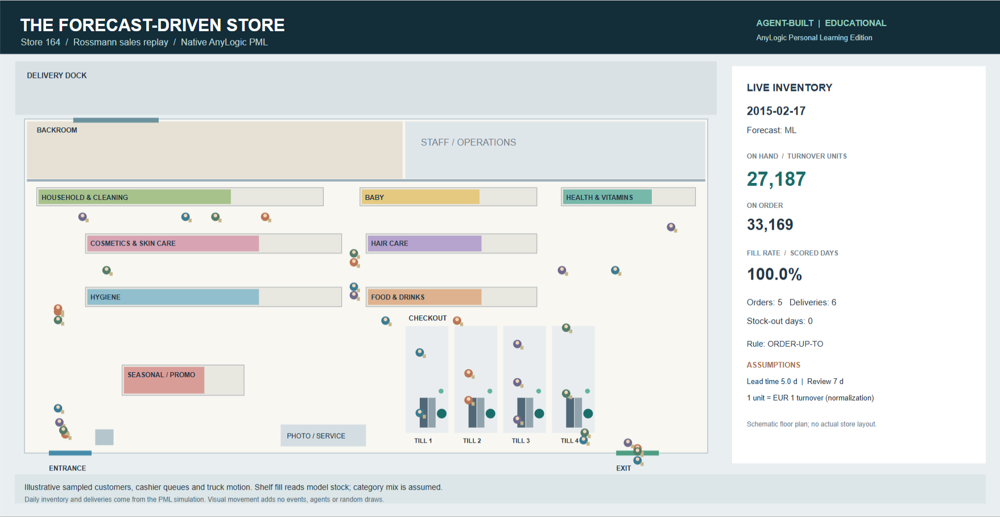
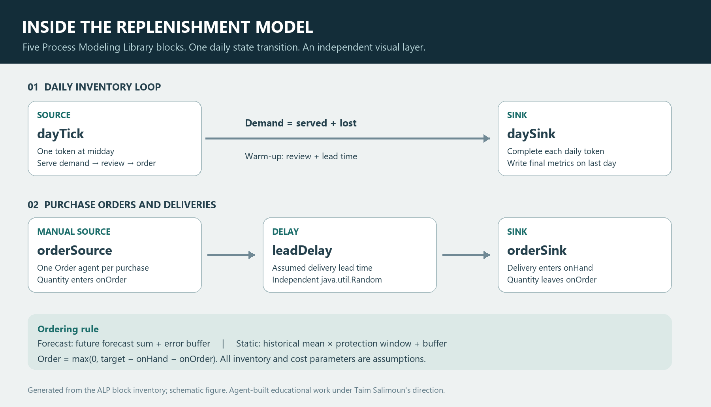

# Forecast-informed replenishment for one Rossmann store

**Store 164 · replay window 5 January–24 June 2015 · educational portfolio report**

Produced by a Claude/Codex AI agent team under Taim Salimoun's direction (tier B attribution). The AnyLogic component uses Personal Learning Edition. This is an assumption-driven inventory experiment, not client work or a live operational digital twin.

## 1. Question and scope

**Can a forecast-informed ordering rule serve more demand for the same stock, or hold less stock for the same service, than simple alternatives?** The project connects a data pipeline to a stateful AnyLogic replenishment model and an illustrative store view.

The requested work is addressed as follows:

1. Prepare and check Rossmann sales/calendar data with SQL and Python.
2. Compare forecasting methods, calibrate errors, and expose assumptions in Excel.
3. Pass a documented file contract into AnyLogic and model ordering, deliveries, sales and lost demand for one store.
4. Compare oracle, seasonal-naive, ML and static ordering rules using common lead-time draws; investigate service versus stock and parameter sensitivity.
5. Present understandable results and a store animation, with clear evidence and authorship limits.
6. Prepare portfolio wording and a personal rebuild path without claiming Taim has completed that rebuild.

This portfolio folder has no course-specific numbered brief or prescribed submission format. The report is Markdown. Resource staffing is outside the quantitative inventory question; the pictured customers and cashiers do not supply queueing results.

## 2. What flows between the tools

| Stage | Input and work | Output contract and checks |
|---|---|---|
| SQL | `train.csv` and `store.csv`; complete the store/day grid, standardise holidays, handle closed days, flag long closures | Clean store/day panel and QA counts; raw and per-store-day derived data remain local |
| Python, P1 | Rolling-origin forecasts, accuracy evaluation, distribution diagnostics and cost assumptions | Accuracy/calibration tables; selected stores; demand, forecast and residual CSVs |
| Excel | Assumed lead time, review period, holding rate, margin and service target | Formula-based cost/sensitivity workbook; saved P1 run reports Excel/Python agreement on 11 comparisons |
| AnyLogic, P2 | P1 CSVs, store 164 and explicit inventory parameters | Daily inventory state, order agents, delivery delays and completion logs |
| Python, P2 | Independently reimplemented daily logic and Java random stream | Native parity checks, larger replica sweeps, matched-stock comparisons and charts |
| Power BI | P1 aggregated CSV exports | Data, DAX measures and a dashboard build guide are prepared; no completed `.pbix` dashboard is claimed |

The real P1 run covers 1,115 stores. Its cleaned grid has 1,050,330 store-days; 33,121 absent raw rows become closed days by rule. It flags 221 stores with a closed run of at least 14 days. These are cleaning assumptions, not proof that every absent observation was a real closure.

The P1→P2 contract selects calibration store 164 plus ten other stores, but **this P2 study models only store 164**. `store_day_demand.csv` contains date, store, turnover-based demand, promotion, holiday and open flags. The three forecast files contain date, store and forecast mean. Residuals retain model, store, date, origin, horizon, actual, forecast and error. Forecast dates run from 5 January to 24 June 2015; each forecast is issued from the latest weekly origin at least five days before its target date (horizons 5–11).

For context, P1's pooled gradient-boosting WAPE is **9.62%** (95% store-bootstrap CI 9.49–9.75%), against **18.08%** (17.85–18.30%) for the mean of four previous same weekdays. P2's `naive` arm uses the **last same weekday**, a different P1 baseline whose pooled WAPE is 23.08%. The P1 pooled figures are not store-164-only accuracy results.

## 3. Inventory logic and assumptions

### Daily sequence and Process Modeling Library blocks

`dayTick` (Source) → `daySink` (Sink) creates one daily token at midday. The source's exit action sells `min(onHand, demand)`, records the unserved remainder as lost demand, and updates scored KPIs. Every seventh day it reviews stock and considers a new order.

`orderSource` (manual Source) → `leadDelay` (Delay) → `orderSink` (Sink) carries one `Order` agent per purchase order. Quantity enters `onOrder` at ordering; receipt removes it from `onOrder` and adds it to `onHand`. The delay is lead time minus half a day, so a midday order arrives at the start of its delivery day, before that day's sales.

For review interval `R` and assumed mean lead time `L`, define `W = R + ceil(L)`. The forecast rule sets:

`target = sum(next W available daily forecasts) + z × error_RMSE × sqrt(R + L)`

`order quantity = max(0, target − onHand − onOrder)`

The static rule uses one historical calendar-day mean and standard deviation:

`target = historical_mean × W + z × historical_SD × sqrt(R + L)`

It does not react to the upcoming promotion calendar. Its historical period is 2013–2014 after panel completion, including zero-demand days. Oracle substitutes future actual sales and has zero forecast-error buffer; it is an unattainable information reference, not an optimised lower bound on stock.

| Parameter | Base assumption |
|---|---|
| Inventory unit | One unit represents one assumed EUR of turnover, not one physical item; even the currency interpretation is assumed |
| Review period | 7 calendar days |
| Lead time | 4, 5 or 6 days with probabilities 0.25, 0.50, 0.25 |
| Safety factor | Initial native comparison: 1.64485; exploratory replica grid: −2 to 3 in steps of 0.25 |
| Holding rate / margin / order cost | 25% per year / 30% / EUR 50 per scored order |
| Starting stock | Actual demand of the first 12 days, identical across arms; first 12 days excluded from KPIs |
| Scored horizon | 159 calendar days after the warm-up; no additional random demand noise |
| Random stream | `java.util.Random(20000 + repSeed)`; one draw on every review, even when no order is placed |

The random-stream rule gives all arms the same supplier conditions for a seed. It also prevents one policy's decision not to order from shifting later draws. Negative grid values reduce the target below the mean-demand term; they are diagnostic safety offsets, not negative service probabilities.

### KPIs

| KPI | Exact meaning in this model |
|---|---|
| Fill rate | Total demand served / total demand over scored days; demand-weighted, not an average of daily percentages |
| Promotion / ordinary-day fill | The same ratio restricted to each day's promotion flag |
| Stock-out days | Scored days with more than `1e-9` unserved units |
| Mean on-hand stock | Arithmetic mean of stock remaining after each scored day's sales |
| Holding cost | Sum of closing stock × unit price × (1−margin) × holding rate / 365 |
| Shortage cost | Lost units × margin × unit price |
| Total cost | Holding + shortage + scored order costs |

Mean stock and holding cost use **daily closing stock**, not the continuous-time average of inventory. The standard team queueing definitions remain: utilization = “Fraction of time a resource unit is busy”; queue size = “Number of agents currently waiting for a resource”; waiting time = “Time an agent spends in a queue before being served”; time in system = “Total time from arrival (`Source`) to departure (`Sink`)”. These four KPIs are **not measured** by the decorative customer/cashier view.

## 4. Experiments and evidence

| Experiment | Scope | Execution and result | Evidence |
|---|---|---|---|
| Initial source comparison | Oracle, naive, ML × seeds 1–10; base assumptions | 30 completed native runs; all three have 100% fill and zero stock-out days | `results/analysis/analysis.json`, `summary_by_source.csv`, `paired_differences.csv` |
| Static-rule first check | Static, `z=1`, seed 1 | One earlier native run: about 88.3% fill, 23 stock-out days and 16,945 mean stock; seven compared quantities matched the replica | Local native `test12` log; historical handoff |
| Frontier spot checks | Four rules × `z=0,2` × seeds 1,4 | 16 additional native runs; every parity, common-random-number and daily sales-balance check passed | `results/analysis/native_spotchecks.json` |
| Animated regression | ML, seed 1, native `Animation` experiment | Separate completed run: 171 daily records, exact daily/delivery/random-stream match to native baseline; zero difference across 17 summary quantities | `results/analysis/animation_verification.json` |
| Service/stock frontier | Four rules × 21 offsets × ten seeds, `L=5` | 840 **Python replica** evaluations; interpolation at 90%, 95% and 99% fill | `results/analysis/frontier/frontier_by_arm.csv`, `stock_needed_for_service.csv` |
| Matched stock | 22,000 and 25,000 average stock; ML, static, naive | Replica grid interpolated within each seed; paired Student-t intervals across ten seeds | `results/analysis/frontier/fair_comparison.json` |
| Lead-time sensitivity | `L=3,5,7,9`; same four rules and offset grid | Replica results; native grid was not completed | `results/analysis/frontier/leadtime_sensitivity.csv` |
| Margin sensitivity | Margins 15%, 30%, 50%; fixed `z=1`, `L=5` | Replica costs revalued; policy not reoptimised | `results/analysis/frontier/margin_sensitivity.csv` |
| Native grid experiments | `PolicySweep`, `LeadTimeSensitivity` | Earlier 180-run sweep hung without logs; no full native grid result claimed | `HANDOFF.md`; resumed diagnostic described below |

The original 30 native runs match the independent replica with maximum absolute difference **1.09 × 10⁻¹¹**. The new 16-run set has maximum difference **1.82 × 10⁻¹¹**. Every original run ended at model day 170.5. These are numerical implementation checks; they do not validate the assumed lead times or costs against a real store.

The resumed native check set completed using a private Eclipse workspace. Inspection of the old process found a workspace-lock wait before source generation. This explains the observed no-progress launch condition; it does not establish that the original large parameter grid has successfully run. The full native grid remains unverified.

### Initial native comparison: equal service, different buffers

| Forecast source | Fill | Mean closing stock | Total assumed cost over 159 scored days |
|---|---:|---:|---:|
| Oracle | 100% | 22,280 | EUR 2,798 |
| ML | 100% | 28,595 | EUR 3,280 |
| Last-same-weekday naive | 100% | 37,521 | EUR 3,960 |

All rows have 22 scored orders. Paired ML minus naive differences are −8,926 stock units (95% CI −9,063 to −8,789) and −EUR 680 total cost (−691 to −670). Since every arm avoids shortages, this comparison mainly shows the consequence of its forecast-error buffer. It does not establish a service advantage.

### Matched stock: the clearer promotion result

At **22,000 mean closing stock units**, the replica produces:

| Rule | Overall fill | Promotion-day fill | Ordinary-day fill |
|---|---:|---:|---:|
| ML | 98.91% | 99.81% | 97.83% |
| Static | 96.31% | 95.87% | 96.85% |
| Naive | 93.78% | 91.68% | 96.30% |

| Paired difference at 22,000 stock | Mean improvement | 95% CI |
|---|---:|---:|
| ML − static, overall fill | +2.60 percentage points | +1.69 to +3.51 |
| ML − static, promotion fill | **+3.94 percentage points** | **+2.97 to +4.92** |
| ML − naive, promotion fill | +8.13 percentage points | +7.29 to +8.97 |
| ML − static, ordinary-day fill | +0.98 percentage points | −0.05 to +2.01 |

The ordinary-day ML/static interval includes zero. The promotion advantage is stronger in this replay. It is a policy comparison conditioned on the recorded promotion calendar, not evidence that promotions causally improve forecasting or sales.

Matching uses linear interpolation between tested offsets **within each seed**, with no extrapolation. Each seed may need a different offset to reach the same stock. This is an exploratory frontier comparison, not a prospectively chosen implementable policy. Intervals cover only supplier lead-time randomness, not uncertainty in demand, model selection, calibration or interpolation.

### Stock required for a service target

The following replica estimates interpolate the **mean curves across seeds**. They differ slightly from averaging separately interpolated seed curves.

| Rule | Stock for 90% fill | Stock for 95% fill | Stock for 99% fill |
|---|---:|---:|---:|
| ML | 16,057 | 18,556 | **22,237** |
| Static | 18,387 | 21,007 | **25,555** |
| Naive | 19,495 | 23,016 | **29,579** |
| Oracle | 22,280 | 22,280 | 22,280 |

At 99% fill, static needs about **15% more stock than ML** and naive about **33% more**, using ML as the denominator. Equivalently, ML uses about 13% less than static. The oracle row is flat because its error spread is zero and the grid changes only that buffer; it is not a tuned oracle frontier. ML appearing slightly below oracle here does not mean it has better information.

For paired uncertainty, interpolate each seed separately: ML minus static stock at 99% fill is **−3,411 units** (95% CI −4,654 to −2,168), and ML minus naive is −7,318 (−8,334 to −6,302). These intervals belong to that per-seed calculation, not directly to the mean-curve point estimates above.

*Figure 1. Replica frontier, ten lead-time seeds per point, assumed mean lead time five days. The full chart is not a native AnyLogic sweep.*

### Sensitivity and the meaning of efficient

| Assumed mean lead time | ML stock at 99% fill | Static | Naive | Oracle |
|---|---:|---:|---:|---:|
| 3 days | 22,257 | 24,318 | 26,618 | 22,421 |
| 5 days | 22,237 | 25,555 | 29,579 | 22,280 |
| 7 days | 20,473 | 20,494 | 26,382 | 19,198 |
| 9 days | 21,981 | 22,901 | 24,227 | 22,288 |

These replica estimates are not monotonic in lead time. Changing lead time also changes the protection window, warm-up and its alignment with the fixed demand calendar; forecasts retain the original horizon-5–11 export. The seven-day result almost removes ML's advantage over static. The table therefore does not establish that longer lead times reduce the inventory a real store needs.

At fixed `z=1`, revaluing margins 15%→50% changes ML's total assumed cost from EUR 3,578→2,875 and static's from EUR 20,587→61,779. A higher margin reduces the assumed acquisition-value basis of holding cost while making lost demand more costly. This is an accounting sensitivity at a fixed policy, not a measured financial return or an optimised economic choice.

For the base five-day scenario, “efficient” means less closing stock at a stated fill target, or more fill at stated closing stock. ML is preferable to static and naive on those exploratory comparisons. No universal optimum or actual monetary saving is established.

## 5. Store view and interpretation

The animation is a schematic generic drugstore, not a surveyed plan of store 164. It shows aisles, aggregate shelf/backroom stock, delivery activity, customers and cashiers. Shelf categories do not have independent inventory records: their fill represents the single aggregate stock state. Customer movement and checkout activity are illustrative; they cannot validate staffing, queue length or waiting time.

**Verification status:** the native `Animation` experiment was visually verified running with ML selected and `visualOn=true`, then completed **171 daily records** at model time **170.5 days**. All daily, delivery and lead-time random-stream records (`P2_DAY`, `P2_RECV`, `P2_CRN`) exactly equal the verified native ML/seed-1 baseline; all **17 completion-summary quantities have zero difference**. This is one separate animated regression beyond the 46 baseline/spot-check runs, and it confirms that the presentation preserved inventory behaviour. The animated PML run exceeded five model hours. Evidence: `results/analysis/animation_verification.json`.

The authentic native recording has **96 frames, 87 distinct**, and an 18.24-second encoded duration. `model/capture-manifest.json` records that processing was limited to crop/rescale/palette/video encoding. `tools/animation_scene.py` uses read-only display expressions. Truck movement, customer paths and cashier activity are illustrative, while inventory labels and shelf bars read the live model. No animation-derived operational KPI or verified 3D walkthrough is claimed.

*Figure 2. Captured native store window; schematic layout and illustrative customers/cashiers. See the [recorded animation GIF](../model/store-animation.gif) or [MP4 clip](../model/store-animation.mp4).*

*Figure 3. Generated explanation of the daily and order/delivery branches. This is a schematic, not an AnyLogic editor-canvas screenshot.*

The [PDF model description](../model/model-description.pdf) is a companion artifact. The report's assumptions describe the schematic layout and decorative movement; the captured native window supplies visual runtime evidence.

## 6. Limits and next defensible step

- Rossmann supplies sales, not true unconstrained demand. Recorded sales are replayed as demand; underlying historical stock-outs cannot be identified. There are no observed stock, orders, supplier lead times or costs to validate against.
- Safety-stock errors are calibrated on the same January–June window used to evaluate the inventory model. Frontier offsets are also tuned on that window. Neither exercise is an untouched hold-out policy test; July 2015 remains unscored.
- Store 164 has no raw observations for July–December 2014. Panel completion treats these dates as closed/zero sales, materially affecting the static historical mean and spread. A different missing-data assumption may change the comparison.
- The `sqrt(R+L)` buffer assumes independent daily errors. P1 diagnostics reject independence for many stores; the buffer does not model correlated error over the protection window directly.
- Starting stock uses future actual demand. Warm-up reduces its effect but does not prove that influence has disappeared.
- Near the window end, forecast sums are truncated to available dates, and orders arriving beyond the window are suppressed. There is no terminal-stock adjustment. Closing-stock comparisons therefore include end-of-window effects.
- Forecast/calendar information is assumed available. Delivery-day sensitivity does not regenerate forecasts for each different operational horizon.
- Ten lead-time seeds do not represent uncertainty about future demand. One store and one short period cannot establish chain-wide performance, causality or commercial benefit.

The next stronger study would freeze policy/calibration on a separate earlier period, resolve missing-history handling, extend the delivery horizon beyond scoring, and evaluate an untouched period with observed operating assumptions where possible. The current work establishes a reproducible educational experiment and numerical agreement between two implementations.

## 7. Authorship, outstanding work and source index

Taim directed and reviewed an AI team; Claude/Codex agents produced code, model generation, analysis and documentation. The project is not represented as hand-built. Taim's own-it work remains: rebuild the seasonal-naive baseline/WAPE and the inventory loop personally, explain the random streams and assumptions, and record that separate work when completed. Power BI Desktop assembly also remains personal work; CSVs/DAX/guide are not a dashboard.

### Focused own-it exercises for Taim

These are exercises to complete personally, not checked-off achievements.

1. **One forecast, one error score.** For one store, implement the last-same-weekday forecast using only values available at each origin. Compute WAPE as `sum(abs(actual−forecast))/sum(actual)`. Show one date's information cutoff and explain how the four-week-average baseline differs.
2. **Build the daily branch.** In a fresh AnyLogic model, add a Source named `dayTick` and Sink named `daySink`, connect them, and set a daily midday arrival. Start with seven hand-written daily demands and fixed starting stock. In the Source exit action, calculate served demand, lost demand and closing stock; verify `demand = served + lost` by hand for each day.
3. **Build the delivery branch.** Add manual Source `orderSource`, Delay `leadDelay` and Sink `orderSink`. Store quantity and lead time on each Order agent. Inject one known order, delay it by lead time minus half a day, and verify its receipt once. Show that `onHand + onOrder` changes correctly at order placement and receipt.
4. **Add the review decision.** Review every seven days; sum the next protection window, add the error buffer, subtract the inventory position, and cap the quantity below at zero. Work one review calculation on paper before comparing the log.
5. **Add fair comparisons.** Use the dedicated Java lead-time stream, draw on every review and run two forecast sources with the same seed. Explain why identical seeds are insufficient if one arm skips draws. Then replace the forecast sum with the static historical target.
6. **Define what the result means.** Exclude warm-up days, compute a demand-weighted fill rate and a mean of closing stocks, and contrast that stock measure with a time-weighted average. Explain why 100% fill does not imply equal forecasts and why the oracle is not a deployable policy.
7. **Make one honest presentation.** Build a Power BI page from the supplied data/DAX guide, or capture a verified native model view, then annotate its assumptions and evidence type. Do not infer queue performance from cosmetic customers.

Completion evidence should be Taim's separately saved model/code, a worked review calculation, one checked log and an explanation in his own words. These exercises do not require changing the verified agent-built implementation first.

No simulated KPI needs to be guessed or filled in to support the tables above. The native 2D scene has passed visual acceptance, authentic recording and the complete animated-run inventory regression. The requested single-store implementation is complete. Taim's personal rebuild and Power BI Desktop assembly remain separate learning/presentation steps. More stores and untouched-period validation are future extensions, not missing acceptance items for this version. The failed full native grid remains explicitly unrun; no missing native grid value is represented by a replica number without its label.

Primary local evidence: P1 `outputs/run_summary.json` and `outputs/CONTRACT.md`; P2 `results/analysis/analysis.json`, `summary_by_source.csv`, `paired_differences.csv`, `native_spotchecks.json` and `animation_verification.json`; frontier `fair_comparison.json`, `stock_needed_for_service.csv`, `leadtime_sensitivity.csv` and `margin_sensitivity.csv`; authentic-recording provenance in `model/capture-manifest.json`. Code definitions: `tools/build_model.py`, `analysis/p2_analysis.py`, `analysis/p2_sweeps.py`, `analysis/p2_frontier.py` and `analysis/fair_comparison.py`. Daily native logs are local derived data and are not distributed with portfolio copy.
